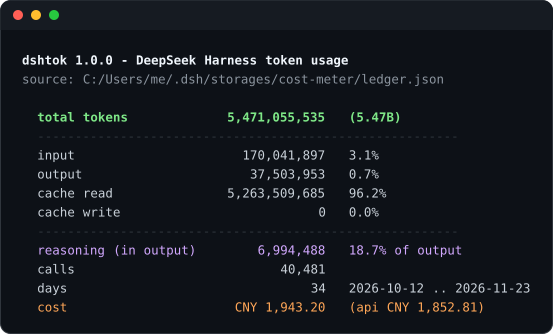

# dshtok

**See how many tokens you have burned in DeepSeek Harness — in total.**

[](https://github.com/Jiu-Love-Yi/dshtok/actions/workflows/ci.yml)
[](https://github.com/Jiu-Love-Yi/dshtok/releases)
[](LICENSE)
[](#requirements)
[](#requirements)

`dshtok` (DeepSeek Harness tokens) is a small C99 command line tool with no third-party
dependencies — the only external archive it links is `libm`, which ships with the
compiler. It reads the usage ledger that the `dsh-cost-meter` plugin writes and reports
how many tokens you have consumed: one auditable lifetime number, plus per-day, per-model
and per-session breakdowns.



That card is a rendering of a real 34-day ledger — the path is shortened — and the same
run as text, so the layout can be read (and grepped) without an image:

```
dshtok 1.0.0 - DeepSeek Harness token usage
source: C:/Users/me/.dsh/storages/cost-meter/ledger.json

  total tokens             5,471,055,535   (5.47B)
  --------------------------------------------------------
  input                      170,041,897   3.1%
  output                      37,503,953   0.7%
  cache read               5,263,509,685   96.2%
  cache write                          0   0.0%
  --------------------------------------------------------
  reasoning (in output)        6,994,488   18.7% of output
  calls                           40,481
  days                                34   2026-10-12 .. 2026-11-23
  cost                      CNY 1,943.20   (api CNY 1,852.81)
```

Your numbers will differ. Note that `api cost` sits close to `cost` here because almost all
of this machine's usage was pay-per-token; the two only pull apart when a plan
subscription covers a large share of the calls.

## Why

DeepSeek Harness and its plugins report cost per session, per turn, per day. That answers
"what did this conversation cost". It does not answer the question people actually ask
when they compare workflows or models: **how many tokens have I burned, in total, across
everything, ever** — and can I check that number myself.

`dshtok` answers that with one number derived from one local file, using rules that are
written down and testable rather than a dashboard you have to trust. It is deliberately
small: no network, no daemon, no plugin, no configuration beyond an optional `--path`.

## How it compares

There are three ways to get a token total out of DeepSeek Harness, and they are not
interchangeable: the first one cannot work without the second one.

| | `dshtok` | `dsh-cost-meter` | your own script |
| --- | --- | --- | --- |
| What you get | one lifetime token number, scriptable | cost, quotas, balances, trends in a GUI | whatever you code |
| Role in the chain | reads the ledger | **writes** the ledger | reads whatever you point it at |
| Runtime | one C binary, no Node | Node 20+, inside a DSH profile | depends on you |
| Network | never | for price sync and balances | depends on you |
| Output | text, JSON, CSV | web UI widgets and panels | depends on you |
| Rule for "a token" | written down, `docs/data-source.md` | correct, spread across a billing engine | yours to document |
| Install | one binary, or `make` | `dsh plugin add` and a restart | you maintain it |

The plugin is the bigger product and the more useful one for day-to-day work: it is where
the data is recorded, and it answers cost questions that `dshtok` does not try to answer.
As of version 1.9.33 its only command line entry point is a session-repair utility, so a
script that wants a number has to parse something the GUI shows rather than ask for it.
That is the gap `dshtok` fills — a stable, documented, offline one-liner for scripts,
cron jobs, shell prompts and "did this workflow actually burn more tokens than the last
one" comparisons. If you want cost, quotas and graphs, install the plugin and use its
dashboard.

Writing it yourself is a reasonable third option, and `docs/data-source.md` is most of the
work: it explains which file to read, why the four buckets add up, and why `reasoning`
must stay out of the sum. What you would still have to build is the JSON parser, the
merging of sessions that span midnight, and the range filtering.

## Requirements

1. **The `dsh-cost-meter` plugin must be installed and must have recorded at least one
   request.** `dshtok` reads the ledger that plugin writes. Without the plugin there is
   no data, and `dshtok` says so instead of printing zero.
2. Any C99 compiler: gcc, clang, MinGW-w64, MSVC.

### Installing the plugin (this is the part that produces the data)

`dsh-cost-meter` is a third-party plugin, MIT licensed, by Han-1413141:
<https://github.com/Han-1413141/dsh-cost-meter> (the version this documentation was
written against is 1.9.33). `dshtok` is **not** affiliated with it and does not bundle it.

It is a normal DSH profile bundle. Either add it with the DSH plugin command:

```sh
dsh plugin --profile web add dsh-cost-meter
```

or add the package to the profile's `package.json` yourself — once under `dependencies`
and once in the `dsh.profile.bundles` array — where `<profile>` is normally `web` or
`desktop`:

```text
$DSH_HOME/profiles/<profile>/package.json
```

```json
{
  "dependencies": { "dsh-cost-meter": "1.9.33" },
  "dsh": { "profile": { "bundles": ["...", "dsh-cost-meter"] } }
}
```

Restart `dsh web` (or the desktop app) afterwards; plugin bundles are scanned at startup.
`--profile` on the `dsh plugin` command selects the DSH profile, not a profile of ours.
Once the plugin is loaded, send one prompt and the ledger appears. See the plugin's own
README for pnpm and Node version requirements.

## Install

### Prebuilt binaries

Tagged releases (`v1.0.0` and later) carry three binaries, built by
[`.github/workflows/release.yml`](.github/workflows/release.yml) on a tag push — and only
after the full test suite passes on that platform:

| Asset | Platform |
| --- | --- |
| `dshtok-linux-x86_64` | Linux, glibc, x86_64 |
| `dshtok-macos-universal` | macOS, arm64 and x86_64 in one file |
| `dshtok-windows-x86_64.exe` | Windows 10+, 64-bit, no runtime DLLs |

Every release also publishes `SHA256SUMS` covering those three files, so a download can be
checked by hand:

```sh
sha256sum -c SHA256SUMS          # shasum -a 256 -c on macOS
```

On Linux and macOS there is a one-line installer. It picks the asset for the machine,
verifies it against `SHA256SUMS`, and installs it to `~/.local/bin`:

```sh
curl -fsSL https://raw.githubusercontent.com/Jiu-Love-Yi/dshtok/HEAD/scripts/install.sh | sh
```

It stops when the checksum does not match, never calls `sudo`, and prints the line to add
to `PATH` if the install directory is not on it. `DSHTOK_VERSION=v1.0.0` pins a release
and `DSHTOK_INSTALL_DIR=/usr/local/bin` changes the destination; the script's header lists
the rest. On Windows, download the `.exe` from the Releases page and put it somewhere on
`PATH` — there is nothing to install beyond the file itself.

The macOS binary is not notarized, because there is no Apple developer account behind this
project. A binary fetched with `curl` is not quarantined and runs as it is; one downloaded
through a browser may need `xattr -d com.apple.quarantine dshtok` first.

If the release you are looking at has no assets attached yet, build from source below —
nothing else in this README depends on a release existing.

### From source

With make:

```sh
make            # -> build/dshtok  (build/dshtok.exe on Windows)
./build/dshtok total
```

Or with CMake, which mirrors the same targets:

```sh
cmake -S . -B build-cmake
cmake --build build-cmake
ctest --test-dir build-cmake --output-on-failure
```

The build needs nothing beyond a C99 compiler and the standard library. Defaults are
`CC=cc`, `CFLAGS=-std=c99 -O2 -Wall -Wextra -Wpedantic -Iinclude`; override them the
usual make way. `make test` builds and runs the test suite, `make integration` runs the
shell smoke test, `make installer` exercises `scripts/install.sh` against a local fake
release (download, checksum, install mode, and the two failure paths), and `make release`
does a clean rebuild with `-O2 -DNDEBUG`, statically where the platform allows.

On Windows, make recipes are POSIX `sh`: run `mingw32-make` from an MSYS2 or Git Bash
shell. Plain `cmd.exe` is not a supported recipe shell.

The only library beyond the compiler's own runtime is `libm` (`floor`, `ceil`, `pow`,
`fabs`), which ships with every C implementation; the default link line adds `-lm` for
the platforms that keep it in a separate archive.

`scripts/install.sh` and the release workflow share the asset names above; renaming one
without the other makes the installer download a 404, which is how the smoke test in
`tests/installer.sh` catches it.

## Usage

The complete output of `dshtok --help`:

```console
dshtok 1.0.0 - DeepSeek Harness token usage

Reports how many tokens DeepSeek Harness has used in total, read from
the ledger written by the dsh-cost-meter plugin.

usage: dshtok [OPTIONS] [COMMAND]

commands
  total      cumulative totals (default)
  daily      one line per day
  models     totals grouped by provider:model
  sessions   per-session leaderboard
  doctor     show where the ledger was looked for and what was found
  help       show this help

options
  -p, --path FILE   read this ledger.json instead of auto-detecting
      --profile N   look under profiles/N when auto-detecting
      --since DATE  include days >= DATE (YYYY-MM-DD)
      --until DATE  include days <= DATE (YYYY-MM-DD)
      --top N       rows shown by 'sessions' and 'models'
      --json        machine readable output
      --csv         CSV output for daily, models and sessions
  -u, --unicode     allow UTF-8 box drawing and the currency symbol
      --no-color    disable ANSI colour
      --no-header   omit the title and source lines
  -q, --quiet       print only the total token count
  -v, --verbose     include the model breakdown
  -h, --help        show this help
  -V, --version     show the version

environment
  DSH_HOME          DeepSeek Harness home directory (default ~/.dsh)
  DSHTOK_LEDGER     explicit path to ledger.json
  DSH_PROFILE_DIR   derive the home from a profile directory

exit codes
  0 success   1 runtime error   2 usage error
```

Without `--top`, every row is shown. Dates are inclusive on both ends and compared as
`YYYY-MM-DD` strings, which sorts chronologically. A date that does not exist on the
calendar (`2026-02-30`, `2026-13-99`) is rejected as a usage error rather than quietly
filtering everything out. Exit code `1` covers a ledger that is missing, unreadable or
malformed; `2` means you called `dshtok` wrong, and those errors are detected before the
ledger is opened.

Numbers are grouped with `,` in every locale, never a locale-specific separator; the
compact form in parentheses appears only when the value is at least 10,000.

`--unicode` swaps the ASCII furniture for typographic characters: an em dash in the title
line, box-drawing rules instead of `-`, and the ledger's own currency symbol (`¥` here)
instead of the currency code. The default is ASCII so that a redirected run, a CI log or a
legacy Windows console cannot garble it.

### Examples

The samples below were captured from real runs against a real ledger. They all pass
`--no-header` so the capture starts at the table; without it every command prints the
title and `source:` lines shown at the top of this file first.

Totals for everything in the ledger:

```sh
dshtok
dshtok total --since 2026-11-01 --until 2026-11-30
```

One line per day, with a total row at the bottom. Columns are `date`, `input`, `output`,
`cache read`, `cache write`, `total` and `calls`:

```sh
dshtok daily
dshtok daily --since 2026-11-01 --until 2026-11-07
```

```console
$ dshtok daily --since 2026-11-20 --no-header
    date                input         output       cache read    cache write           total    calls
  2026-11-20      1,545,159        332,016       40,251,469              0      42,128,644      353
  2026-11-21      7,954,083      2,109,175      270,332,043              0     280,395,301    1,696
  2026-11-22      4,815,262      1,695,541      315,443,768              0     321,954,571    1,659
  2026-11-23      4,902,836      2,445,765      519,210,368              0     526,558,969    2,534
  total          19,217,340      6,582,497    1,145,237,648              0   1,171,037,485    6,242
```

The `total` row covers the days that were actually printed, so a `--since`/`--until` run
totals only the selected range. The same 34-day ledger over its full span totals the
5,208,779,846 shown at the top of this file.

Per-model totals. The key is whatever the plugin recorded as `provider:model`, merged
across days, with each model's share of the whole ledger:

```sh
dshtok models --top 10
```

```console
$ dshtok models --top 3 --no-header
  #  provider:model                                  total tokens    share
  1  minimax-plan:MiniMax-M3                        3,099,666,305    59.5%
  2  opencode-go:deepseek-v4.1-flash                1,346,107,277    25.8%
  3  minimax-cn:MiniMax-M3                            515,834,146     9.9%
```

The per-session leaderboard. A session that ran past midnight is merged into one row, and
long titles are truncated (never mid-character):

```sh
dshtok sessions --top 20
```

```console
$ dshtok sessions --top 1 --no-header
  #  date          total tokens     calls  title
  1  2026-11-09   3,378,375,591    20,092  src漏洞挖掘详细步骤
```

Where did it look, and what did it find? `doctor` is the troubleshooting command: it shows
the paths it would try, which file won, that file's size, and the shape of what is inside.
This sample points at one of the test fixtures, so it is short:

```console
$ dshtok doctor --path tests/fixtures/ledger_basic.json
dshtok 1.0.0 - DeepSeek Harness token usage

search
  DSH_HOME             C:\Users\me\.dsh
  DSHTOK_LEDGER        (unset)
  candidates
                      (none: --path was given, no search was done)

ledger
  path                 tests/fixtures/ledger_basic.json
  size                 2,093 bytes (2.0 KB)
  status               ok
  days                                 2
  range                2026-01-10 .. 2026-01-11
  sessions                             2
  models                               2
  calls                                7
  tokens                           1,100
  currency             CNY  (2 decimals)
```

Point it at the real default location by dropping `--path` and you get the candidate list
instead of `(none: --path was given, no search was done)`.

Machine-readable output, for a script or a spreadsheet:

```sh
dshtok total --json
dshtok daily --json
dshtok total --verbose --json
```

`--json` prints one object: `tool`, `version`, `source`, `currency`, `range`, then the
body for the command you asked for. `daily` emits `days`, `models` emits `models`,
`sessions` emits `sessions`, and `total` emits `total` plus `days_count` (the number of
days covered); `total --verbose` additionally emits all three arrays. Each entry repeats
the bucket fields next to its own identity — `date` for a day, `name` for a model, `id`
and `date` for a session — and `models` entries also carry `share`, a percentage of the
whole. `doctor` always prints its human-readable report instead.

`--csv` is available for `daily`, `models` and `sessions`: a header row, then one row per
entry, comma separated, `\n` line endings, text fields quoted with `"` and inner quotes
doubled, numbers unquoted, no BOM. The column sets are fixed:

```text
daily     date,input,output,cacheRead,cacheWrite,tokens,calls,cost,apiCost
models    name,tokens,input,output,cacheRead,cacheWrite,calls,cost,apiCost
sessions  id,date,tokens,calls,title
```

Just the number, for shell arithmetic. `-q` prints the headline total on one line with no
labels, whatever the command, and it still honours `--since` / `--until`. `doctor` ignores
it and prints its report:

```sh
dshtok -q total
```

## What counts as a token

The headline number is:

```
total tokens = input + output + cacheRead + cacheWrite
```

- `input` is prompt text that was not served from cache.
- `output` is everything the model generated.
- `cacheRead` is prompt text served from the provider's prompt cache.
- `cacheWrite` is prompt text written into that cache.

`input`, `cacheRead` and `cacheWrite` are **mutually exclusive buckets**: input on this
side of the wire is either a cache read, a cache write, or neither — never two of them.
So summing them cannot double count, and the "prompt tokens" column of a third-party
bill is `input + cacheRead + cacheWrite`.

`reasoning` is **not** added to the total. Reasoning tokens are reported separately by
the API but they overlap `output` — adding them would count the same tokens twice.
`dshtok` prints reasoning on its own line and shows it as a share of output.

The full derivation, including the exact wording from the plugin's documentation and
source, is in [docs/data-source.md](docs/data-source.md).

## Where the data comes from

`dshtok` reads exactly one file:

| Platform | Path |
| --- | --- |
| Windows | `%USERPROFILE%\.dsh\storages\cost-meter\ledger.json` |
| Linux, macOS | `~/.dsh/storages/cost-meter/ledger.json` |
| anywhere | `$DSH_HOME/storages/cost-meter/ledger.json` when `DSH_HOME` is set |
| explicit | `$DSHTOK_LEDGER`, or `--path FILE` |

`$DSH_HOME` defaults to `~/.dsh` (`%USERPROFILE%\.dsh` on Windows). If it is not set but
`$DSH_PROFILE_DIR` is, the home is taken to be the parent of the `profiles/<name>`
component of that path — the same derivation the host itself uses, which keeps a profiled
install working in a shell that never exported `DSH_HOME`. `--path FILE` skips discovery
entirely. Otherwise the candidates are probed in this order and the first existing file
wins:

1. `$DSHTOK_LEDGER`
2. `$DSH_HOME/storages/cost-meter/ledger.json`, preceded by
   `$DSH_HOME/profiles/<profile>/storages/cost-meter/ledger.json` when `--profile N`
   was given
3. the same pair under `<home>/.dsh`
4. a literal `.dsh` directory in the current working directory
5. on Linux and macOS only, `/home/$USER/.dsh/...` when `HOME` and `USERPROFILE` are both
   unset

Step 5 exists for containers and WSL setups where the shell has no usable `HOME` but the
real home directory still holds `.dsh`. It is a last resort, and the value of `USER` is
rejected if it is empty, contains a `/`, or is `.` or `..`, so it cannot be turned into a
path outside `/home`.

`dshtok doctor` prints the whole candidate list it tried, which one won, the size of that
file in bytes and in a human form, and the shape of what it found — version, day count,
session count, model count and currency. It exits `0` even when there is no ledger,
because "the plugin has not recorded anything yet" is the answer to the question, not a
failure of the program.

To be precise about "no network": `dshtok` reads one file and `stat`s a short list of
candidate paths to find it. It opens no sockets, downloads nothing, uploads nothing and
writes nothing.

## FAQ

**The number is 0, or the ledger is missing.** `dshtok` reads a file the
`dsh-cost-meter` plugin writes. If the plugin is not installed, or is installed but has
never recorded a request, there is nothing to read and `dshtok` exits `1` with the list
of paths it tried. Run `dshtok doctor` to see that list. Install the plugin, restart
DSH, send one prompt, then run `dshtok` again.

**Why does the total look bigger than the number on my provider invoice?** Because it
counts prompt-cache reads, and on an agent workload that is most of the traffic. Cached
prompt tokens are cheap, not free, and they are still tokens you burned. Use `--json`
and look at `total.tokens` against `total.input` to see the split.

**The output looks garbled in my Windows terminal.** Without `--unicode` the layout is
pure ASCII — the only non-ASCII text that can appear is a session title copied verbatim
from the ledger, and only `sessions` prints titles. If everything is mojibake, your
console is not reading UTF-8: switch it to UTF-8 (code page 65001), or accept that titles
render badly. If you passed `--unicode` and saw mojibake, drop it. If you see literal
escape sequences instead of colour, add `--no-color`; colour is only used when stdout is a
terminal anyway, so a piped or redirected run is already plain.

**Does it upload anything?** No. Fully offline: one local file read, no network calls,
no telemetry, no update check.

**Why not read the session logs directly?** `$DSH_HOME/sessions/**/session.v4.jsonl.zstd`
is zstd-compressed, and the C standard library has no zstd. Re-implementing the plugin's
deduplication, cache pricing and plan/API split in C would duplicate an entire billing
engine and drift from it. `dshtok` reads the plugin's already-reconciled ledger instead.

**Why not recompute from `ledger.json.usage-cache/*.json`?** Those are cursor-based
indexes of raw log events, not a complete record. Measured on one real machine they
summed to about 48% of the ledger's own total. Using them would produce a number that is
systematically too low, which is worse than not producing one.

**Can I keep the number stable across machines?** Sort order is deterministic: totals
are exact, percentages and leaderboards are computed after range filtering. But the
data is the data — a machine with a different `config.historyDays` retains a different
window of days, and therefore reports a different total.

**Does it work with a future ledger format?** Missing fields default to zero and unknown
fields are ignored, so a newer plugin that adds fields will not crash `dshtok`. A ledger
with no `days` object is treated as empty and reports zeroes rather than an error — that
is what a freshly installed plugin looks like. A `days` value that is not an object is a
parse error.

## Roadmap

Everything in this section is unimplemented. The rest of this README describes what the
code does today.

Next, in the v1 line:

- Range presets (`--last 7d`, `--this-month`) on top of the existing `--since` / `--until`.
- A trend view: `dshtok daily --chart`, one bar per day, so a spike is visible in a
  terminal without opening a spreadsheet.
- Period-over-period comparison in the text output — the `--json` output already carries
  everything needed to compute it outside the tool.
- A `--compare` mode for two ledger files, for measuring a workflow change across
  machines.

Later, in the v2 line:

- Plan versus metered tokens as separate columns. The ledger splits **cost** into a plan
  and an API track today, not tokens, so this needs the plugin to record a token-side split
  first. `dshtok` will not estimate it.
- A budget alert: `dshtok --budget 2000000000` exiting non-zero once the total crosses the
  line, for a cron job or a CI check.
- A small DSH plugin that shows the `-q` number inside Harness, so the window and the
  terminal display the same figure.
- Native zstd support, if the build ever gains a vendored decompressor worth its weight.
  Until then, reading `sessions/**/*.zstd` directly stays out of scope — see the FAQ.
- Packaging: a `winget` manifest and a Homebrew formula, so Windows and macOS users do not
  need a shell at all. The `curl` installer covers Linux and macOS today, and the release
  already publishes the three binaries these would wrap.

### Repository topics

If you fork or re-publish this, the GitHub topics that describe it are `deepseek`,
`deepseek-harness`, `dsh`, `token-usage`, `cost-meter`, `cli` and `c99`. Topics live on
GitHub, not in a file in the repository.

## License

MIT. See [LICENSE](LICENSE). `dshtok` is not part of DeepSeek Harness and is not
affiliated with DeepSeek or with the `dsh-cost-meter` plugin.

## 中文说明

- `dshtok` 只有一个功能：把 DeepSeek Harness 里累计烧掉的 token 总数算出来，附带按天、
  按模型、按会话的明细。C99，只依赖标准库（外加 `libm`），产出单个可执行文件。
- 数据来源是第三方插件 **dsh-cost-meter**（MIT，
  <https://github.com/Han-1413141/dsh-cost-meter>）写的
  `$DSH_HOME/storages/cost-meter/ledger.json`。**没装这个插件就没有数据**，`dshtok`
  会明确报错而不是显示 0。本项目与它无隶属关系，也不打包它。
- 总数 = `input + output + cacheRead + cacheWrite`。**reasoning 不计入**，因为它是
  output 的子集，加上会重复计数；input / cacheRead / cacheWrite 三者互斥，相加不会
  重复。
- 完全离线：只读一个本地文件，不联网、不上传、不写文件。想换数据文件用
  `--path FILE`。
- 安装：Linux/macOS 一行
  `curl -fsSL https://raw.githubusercontent.com/Jiu-Love-Yi/dshtok/HEAD/scripts/install.sh | sh`，
  或者从 Releases 页下载三个平台的预编译二进制（同页有 `SHA256SUMS` 可校验），或者源码
  `make`。Windows 只有 `.exe` 一个文件，放进 `PATH` 即可。
- `dshtok doctor` 除了列出探测路径，还会给出账本文件大小和里面有多少天、多少会话、
  多少模型，排查"为什么数字是 0"时先跑它。
- 常用：`dshtok`（总计）、`dshtok daily`、`dshtok models`、`dshtok sessions`、
  `dshtok total --json`、`dshtok doctor`（看它找了哪些路径）。
